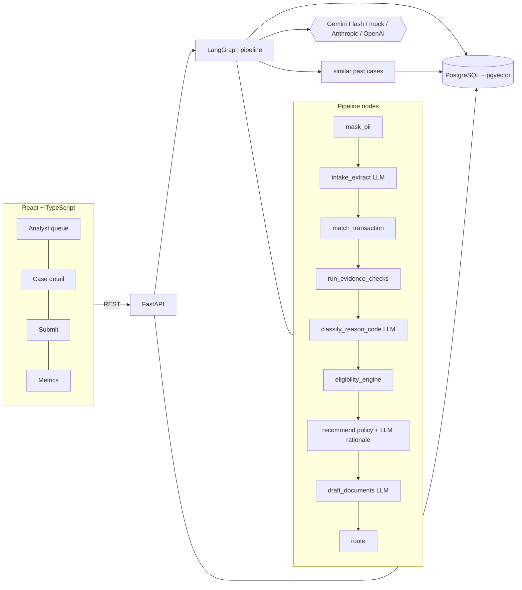

# Architecture

## Who decides what

| Concern | Decided by | Why |
|---|---|---|
| Understanding the complaint, claim extraction | LLM (schema-validated) | Language task |
| Reason-code classification | LLM, bounded by rules | Language task; result is checked against evidence |
| Deadlines, eligibility windows | Python (`rules/eligibility.py`) | Must be exact and reproducible |
| Duplicate detection, amount checks, refund and subscription checks | Python (`tools/evidence.py`) | Money logic |
| Recommended action | Python (`rules/policy.py`) | LLM can explain but cannot change the action |
| Auto-resolve vs human review | Python (`rules/routing.py`) | See below |
| Rationale, customer letter, filing text | LLM, with placeholders filled by code | Writing task; amounts and dates never come from the model |

## Routing

A case auto-resolves only if **all** hold: final confidence >= 0.85, amount <= INR 10,000, reason
code is DUPLICATE_CHARGE or ATM_CASH_NOT_DISPENSED, and the policy recommendation is REFUND
with all checks clear. Rejections, friendly-fraud flags, injection suspicion, ambiguous
transaction matches and pipeline errors always go to a human. Thresholds live in
`backend/app/rules/reason_codes.yaml` only.

Final confidence = min(policy cap, classifier confidence, rationale confidence, match cap).

## Prompt-injection defence

Complaint text is untrusted. (1) Wrapped in delimiters with an instruction to treat it as data,
(2) scanned by a regex detector whose hit forces human review, (3) every LLM output is parsed
against a Pydantic schema, (4) no decision logic is reachable from model text: even a fully
hijacked model could only change wording or a classification that the evidence checks and the
router then test.

## Audit

Every node writes an `audit_events` row (actor, input/output summary, model, prompt version,
tokens, cost in INR, latency). Human reviews add HUMAN events. The UI renders this as a timeline.

## Case memory

Resolved cases are embedded into `case_embeddings` (pgvector). The agent retrieves similar past
cases as context for the rationale. The agent never reads `ground_truth` (enforced by an AST test).
